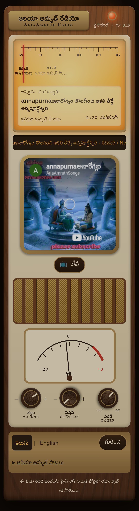

# 📻 AriaAmruth Radio · ఆరియా అమృత్ రేడియో

> ⚠️ **Temporary name.** "AriaAmruth Radio / ఆరియా అమృత్ రేడియో" is a placeholder until Amma picks the real
> station name. Change it in [`config/stations.json`](config/stations.json).

A 1950s valve-radio web app that plays Amma's YouTube songs **like real radio**: every listener hears the
same song at the same second, it loops forever, and **new uploads join automatically** (usually within
1–2 hours). No servers, no database, no cost — GitHub Actions + GitHub Pages.

**Live:** https://stardustmodulator.github.io/amma-radio/



---

## What Shiva still needs to fill in

All in **one file: [`config/stations.json`](config/stations.json)**. Edit it on GitHub (pencil icon) and
commit — the site rebuilds itself in ~2 minutes.

| What                                       | Where in `config/stations.json`                 | Status                                                             |
| ------------------------------------------ | ----------------------------------------------- | ------------------------------------------------------------------ |
| Station name (Telugu + English)            | `stationName.te`, `stationName.en`              | ⚠️ temporary: AriaAmruth Radio / ఆరియా అమృత్ రేడియో                      |
| Telugu tagline                             | `tagline.te`                                    | ⚠️ temporary                                                       |
| Artist name for the © line                 | `artistName`                                    | ⚠️ temporary: AriaAmruthSongs                                      |
| Channel 1                                  | `channels[0]`                                   | ✅ AriaAmruthSongs — `UC6ygpyydpFHCJK_KiXRUVNQ` (@ariaamruthsongs) |
| Her other channels                         | `channels[1…]` + a matching entry in `stations` | ❌ `{{CHANNEL_ID_2}}` placeholder (ignored until filled)           |
| Telugu channel labels                      | `channels[].label.te`, `stations[].label.te`    | ⚠️ temporary                                                       |
| Custom domain                              | DNS + repo settings (see below)                 | ❌ not set yet                                                     |
| YouTube API key (optional but recommended) | repo secret `YOUTUBE_API_KEY`                   | ❌ not set — keyless mode is used                                  |

Anything still written as `{{…}}` is treated as "not filled in" and ignored, so the site never breaks.

### How to find a channel ID

Open the channel → **About** → **Share channel** → **Copy channel ID** (starts with `UC`, 24 characters).
Or view the page source of `https://www.youtube.com/@handle` and search for `"channelId"`.

### Adding a channel (and its own station on the dial)

```jsonc
"channels": [
  { "id": "UC6ygpyydpFHCJK_KiXRUVNQ", "handle": "@ariaamruthsongs", "label": { "en": "AriaAmruth Songs", "te": "ఆరియా అమృత్ పాటలు" } },
  { "id": "UCxxxxxxxxxxxxxxxxxxxxxx", "handle": "@her-second-channel", "label": { "en": "Stories", "te": "కథలు" } }
],
"stations": [
  { "id": "all", "freq": "88.5",  "label": { "en": "All Songs", "te": "అన్ని పాటలు" }, "channels": "*" },
  { "id": "ch1", "freq": "94.3",  "label": { "en": "AriaAmruth Songs", "te": "ఆరియా అమృత్ పాటలు" }, "channels": ["UC6ygpyydpFHCJK_KiXRUVNQ"] },
  { "id": "ch2", "freq": "101.7", "label": { "en": "Stories", "te": "కథలు" }, "channels": ["UCxxxxxxxxxxxxxxxxxxxxxx"] }
]
```

`freq` is where the station sits on the dial (88–108). "All Songs" (`"*"`) mixes every channel.

---

## How new songs get in (two modes)

The hourly job ([`.github/workflows/radio.yml`](.github/workflows/radio.yml)) picks a mode automatically:

|               | **With `YOUTUBE_API_KEY`** (recommended)             | **Without a key** (current)                                                                                                                               |
| ------------- | ---------------------------------------------------- | --------------------------------------------------------------------------------------------------------------------------------------------------------- |
| Finds uploads | YouTube Data API v3 (official)                       | `yt-dlp --flat-playlist` lists the channel's _Videos_ tab (IDs, titles, durations) + official RSS feed                                                    |
| Shorts        | duration ≤ 180 s + Shorts-URL probe                  | anything on the channel's _Shorts_ tab is excluded (the _Videos_ tab never lists Shorts)                                                                  |
| Embeddable?   | `status.embeddable`                                  | official oEmbed endpoint                                                                                                                                  |
| Reliability   | very high; ~100–200 of 10,000 free daily quota units | depends on YouTube not blocking GitHub's servers. If it's blocked, the job logs a warning, **keeps the existing playlist playing**, and retries next hour |

yt-dlp is used **only inside the GitHub Action to read public metadata** — it never downloads or streams
audio/video, and nothing in the website uses it. Audio always plays through YouTube's official embedded player.

### Add the `YOUTUBE_API_KEY` secret (10 minutes, free)

1. Go to <https://console.cloud.google.com/> and sign in with any Google account.
2. Top bar → project picker → **New project** → name it `amma-radio` → **Create**.
3. **APIs & Services → Library** → search **YouTube Data API v3** → **Enable**.
4. **APIs & Services → Credentials → + Create credentials → API key**. Copy it (starts with `AIza`).
5. Click the new key → **API restrictions → Restrict key → YouTube Data API v3** → **Save**.
   (Leave "Application restrictions" as _None_; the key is only used by GitHub Actions, never in the browser.)
6. In GitHub: **this repo → Settings → Secrets and variables → Actions → New repository secret**
   - Name: `YOUTUBE_API_KEY` - Value: the key → **Add secret**.
7. **Actions → "Radio — refresh, build & deploy" → Run workflow** (tick _Re-crawl every upload_ once).

No billing account is needed; the default free quota is 10,000 units/day and this uses ~1–2 % of it.

### Force a refresh

**Actions → Radio — refresh, build & deploy → Run workflow.**

### Exclude a song / include a short song

- `rules.denyVideoIds`: never play these video IDs.
- `rules.allowVideoIds`: play these even if they're ≤ 180 s (overrides the Shorts/duration filters).

---

## Point `radio.<her-domain>` at it (later)

1. At the domain registrar's DNS page add: **Type `CNAME`, Name/Host `radio`, Value `stardustmodulator.github.io.`**
2. GitHub → this repo → **Settings → Pages → Custom domain** → `radio.<her-domain>` → **Save**.
   Wait for the DNS check ✅, then tick **Enforce HTTPS**.
   (With GitHub-Actions deploys the domain lives in Settings; a `CNAME` file isn't needed. If you want one
   anyway, put `public/CNAME` containing `radio.<her-domain>`.)
3. **Settings → Secrets and variables → Actions → Variables → New variable**: `PAGES_BASE` = `/`
   (the site then lives at the domain root instead of `/amma-radio/`). Re-run the workflow.
4. Update `siteUrl` in `config/stations.json`.
5. Recommended: verify the domain under your GitHub account → **Settings → Pages → Verified domains** to prevent takeover.

---

## How the sync works

```
time ─────────────────────────────────────────────────────────────────────▶
       │ song A (237 s) │ song B (207 s) │ song C (240 s) │ NEW upload │ …
       ▲ start=1795100000000   ▲ start = A.start + 237 000 ms      ▲ inserted after the 10-min lock
                 you open the radio here → play B from second 63
```

- The job writes **absolute start times** (unix ms) 48 h ahead. Adding songs never shifts what's playing.
- Each full pass is a **seeded shuffle** (same order for everyone), no immediate repeats across passes.
- New uploads (first seen < 7 days ago) play next, right after the locked next-10-minutes.
- The browser calibrates its clock from the HTTP `Date` header (3 samples, lowest round-trip), then every
  500 ms re-seeks if it drifts > 2 s. Ads (player duration ≠ song duration) pause the correction.
- A video that errors (blocked/removed) is replaced for the rest of its slot by a **deterministic filler**
  that every listener computes identically; the next job run removes it from the schedule.
- If the job stops for days, the radio keeps playing in **fallback mode** (modulo over a stable order).
  Re-enable: **Actions** → the workflow → **Enable workflow** (GitHub pauses crons in repos with no
  activity for 60 days; the hourly data commits normally prevent that).

## YouTube rules we follow

- Audio only via the official IFrame player; never downloaded, proxied or re-streamed.
- The player is always visible (≥ 240×240 "Picture Window"), never covered; **TV** makes it bigger.
- Playback starts only after **POWER** is pressed and the window is at least half on screen.
- Referrer is not suppressed. The API key never reaches the browser (CI checks `grep -r AIza dist`).

## Known limitations

- **Phones:** YouTube usually stops when the screen locks or the browser goes to the background. Lock-screen
  controls may not appear on every device. That's a platform limit, not a bug.
- YouTube may show ads on monetized videos; the radio waits them out and re-syncs.
- Keyless mode depends on yt-dlp; if YouTube blocks it, new songs wait until a key is added (old songs keep playing).
- Listeners are in sync to about ±1–2 s (HTTP `Date` header has 1-second resolution).

## Troubleshooting

| Symptom                                           | Check                                                                                                                                                         |
| ------------------------------------------------- | ------------------------------------------------------------------------------------------------------------------------------------------------------------- |
| New song not appearing                            | Actions → latest run log. Then `data/catalog.json` → find the ID → `reason` (`short`, `too_short`, `not_embeddable`, `private`, `live`, `denied`, `removed`). |
| A real song ≤ 3 min is missing                    | Add its ID to `rules.allowVideoIds`.                                                                                                                          |
| "yt-dlp listing failed" warnings                  | Add the `YOUTUBE_API_KEY` secret (above).                                                                                                                     |
| Site shows old songs only / "Playing from memory" | The hourly job stopped — Actions → enable the workflow / Run workflow.                                                                                        |
| Custom domain 404                                 | Did you set the `PAGES_BASE` variable to `/` and re-run?                                                                                                      |

## Development

```bash
npm ci
npm run dev            # http://localhost:5173/amma-radio/
npm run refresh        # run the playlist job locally (needs yt-dlp on PATH or YOUTUBE_API_KEY in env)
npm run lint && npm run typecheck && npm test
npm run build && npx playwright install chromium && npm run test:e2e
```

Stack: Vite + React 18 + TypeScript (strict), plain CSS + inline SVG, Vitest, Playwright, ESLint, Prettier.
See [`docs/PLAN.md`](docs/PLAN.md) for the architecture.

## Credits

- Sync approach (clock calibration from the lowest-RTT sample, drift re-seek, ad detection) inspired by
  [tahsingibi/orbitcast](https://github.com/tahsingibi/orbitcast) (MIT) — re-implemented here.
- Schedule-as-static-JSON idea from [hfactor/cinema-radio](https://github.com/hfactor/cinema-radio) (idea only).
- Knobs: [react-knob-headless](https://github.com/satelllte/react-knob-headless) (MIT).
- Fonts: Limelight, Ramabhadra, Mandali, Courier Prime (Google Fonts, SIL OFL).
- `public/sounds/static.mp3`: generated with ffmpeg for this project (CC0).
- All songs © AriaAmruthSongs. Code: MIT.
